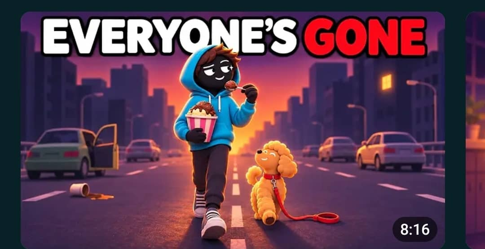
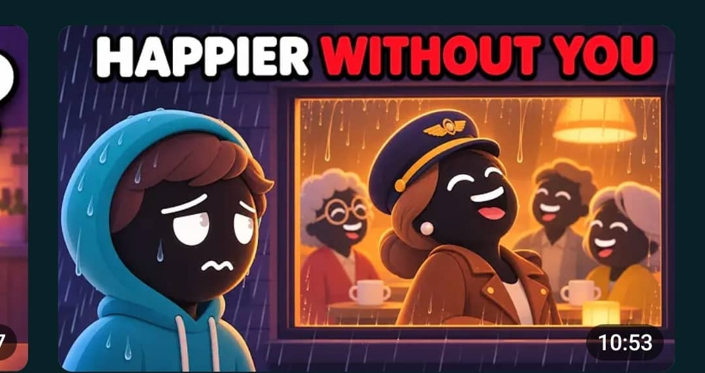
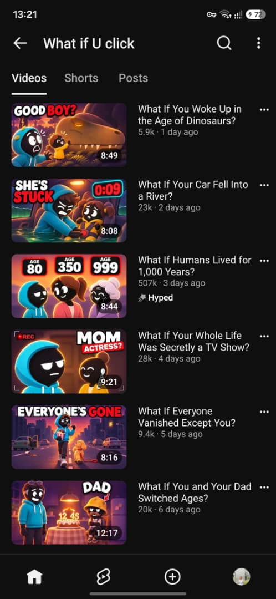
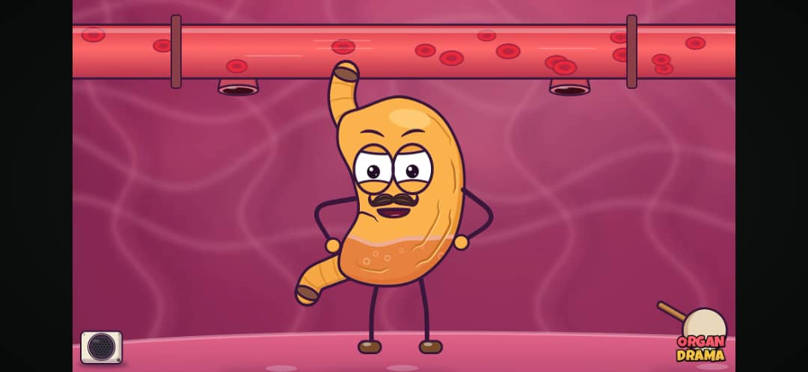
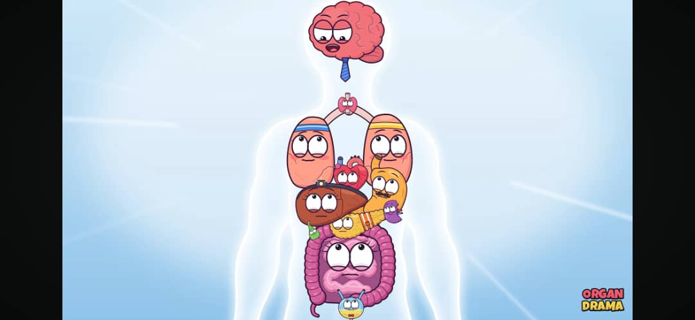

# Health Channel — Character Sheet

The single reference for how everything looks on the channel. The exact wording lives in `channel.py`, which every episode's build reads, so the characters and styles stay identical in every video. Change a character there, rebuild, and all prompts update.

## Reference images

The channel uses two looks: one for **people scenes** and one for **inside-the-body scenes**.

### People scenes

| | |
|---|---|
|  |  |

- **Characters:** chunky rounded people with **smooth deep matte-black skin and faces**, large **white oval eyes with black pupils**, thick **white eyebrows**, and white mouth lines (open mouths show a red tongue). They have full arms, legs and dark rounded hands, **never stick limbs**.
- **Finish:** soft, glossy and slightly 3D, with gradient shading and a gentle rim light.
- **Clothes:** bold and bright, with soft folds.
- **Colour:** bright channel colours by default. Dusk purple, night blue and warm window glow are used only when the scene calls for them, as in the rain-at-night reference.

### Inside-the-body scenes

| | |
|---|---|
|  |  |

- **Rendering:** flat 2D vector, clean flat colours with simple highlights, **thick dark-plum outlines**.
- **Organ characters:** big round white eyes with dark pupils, expressive dark eyebrows and a small mouth. They have thin dark rubber-hose arms and legs, small rounded hands and **small brown shoes**. Each has one small personal accessory.
- **Backgrounds:** soft pink fleshy tissue with lighter wavy vein lines and a red blood-vessel pipe of red cells, *or* a glowing white body outline on a light sky-blue background with organs in their natural positions.
- **Organ colours:** always their **true natural colours**, never recoloured. In the reference the stomach is orange-yellow, but on this channel it stays natural peachy pink, as you asked earlier.

The references guide the art style. The channel's characters have their own accessories and personalities (below), so the channel stays its own rather than a copy of the reference channels.

## People

**Shared description, used in every prompt:** a chunky rounded cartoon person with smooth deep matte-black skin and face, large white oval eyes with black pupils, thick white eyebrows and full arms, legs and dark rounded hands.

### You (main character)

- **Never changes:** deep matte-black face and skin, white oval eyes, **short tufty black curly hair**.
- **Personality:** an ordinary, relatable person; deadpan and a little dramatic about everyday struggles.
- **Signature expressions:** drowsy half-closed eyes, one raised eyebrow, a blank stare with question marks, wide-awake surprise.
- **The outfit fits the scenario.** Each episode picks from this list, and new outfits get added here:

| Scenario | Outfit | Used in |
|---|---|---|
| Work | a formal work outfit: a fitted navy suit jacket and trousers, a crisp white shirt, a sky-blue tie and polished black shoes | ep01 |
| Work Relaxed | the formal work outfit with the suit jacket off and the tie loosened: crisp white shirt, sky-blue tie, navy trousers and black shoes | ep01 |
| Bed | plain sky-blue pyjamas | ep01 |
| Gym | a leaf-green T-shirt, black joggers and white trainers | — |
| Rain | a sunny-yellow raincoat with the hood up, dark jeans and white trainers | — |
| Hospital | a pale-blue patient gown and grey slippers | — |
| Weekend | a coral T-shirt, blue jeans and white trainers | — |

### Recurring cast

| Character | Description |
|---|---|
| **Coworker** | large white oval eyes with black pupils, thick white eyebrows and full arms, legs and dark rounded hands, auburn hair in a high round bun, a tailored coral blazer over a crisp white blouse, slim grey trousers and black heels |
| **Doctor** | large white oval eyes with black pupils, thick white eyebrows and full arms, legs and dark rounded hands, short grey hair, white rectangular glasses, a white coat over a sky-blue shirt and a silver stethoscope |
| **Researcher** | large white oval eyes with black pupils, thick white eyebrows and full arms, legs and dark rounded hands, a neat dark-purple bob, round white glasses and a white lab coat, holding a clipboard |
| **Pizza volunteers** (ep01 only) | Lanky man with a thin grey moustache in a sky-blue T-shirt; stocky bald man with a short grey beard in a leaf-green T-shirt |
| **Ayurvedic physician** (ep01 only) | Neat white beard, small saffron mark on the forehead, white cotton kurta with a cream shawl |

## Organ characters

**Shared description, used in every prompt:** a flat cartoon organ character with a thick dark-plum outline, big round white eyes with dark pupils, expressive dark eyebrows, a small mouth and thin dark rubber-hose arms and legs with small rounded hands and small brown shoes.

| Organ | Natural colour and shape | Accessory | Personality | Voice (see `VOICES.md`) | First used |
|---|---|---|---|---|---|
| **Stomach** | Plump J-shape, soft peachy pink with pinker folds, digestive-juice level with bubbles | Small white chef's hat | Busy kitchen manager, cheerfully bossy | Slightly lower and rounder than the narrator; hearty, practical | ep01 (speaks, beat 57) |
| **Brain** | Soft pinkish grey with clear folds | Slim black headset with mic | Control-room manager, overthinker | Clear, slightly higher and quicker; precise | ep01 |
| **Pancreas** | Long, slightly lumpy, pale creamy yellow-pink | Round reading glasses, pencil | Careful accountant of blood sugar | Light, polite, measured | ep01 |
| **Intestines** | Coiled small intestine in salmon pink, framed by a deeper dusty-pink large intestine | Small orange hard hat | Non-stop worker | Quick, chatty, upbeat | ep01 |
| **Heart** | Deep red, short blue artery on top | — (calm half-lidded eyes) | Steady and reliable | Deep, steady, calm | — |
| **Liver** | Wedge shape, reddish brown | Tiny white coffee mug, droopy eyelids | Overworked filter that has seen it all | Low-mid, slow, dry, a little weary | — |
| **Lungs** | A pair, light pink, spongy texture | One shared long sky-blue scarf | Calm and patient | Soft, airy, unhurried | — |
| **Kidneys** | A pair of beans, reddish brown | Small yellow rubber gloves | Neat cleaners | Brisk, tidy, matter-of-fact | — |

## Prompts to generate your own reference sheets

Generate these once, then attach them as character references in your image tool for every beat.

1. **Main character turnaround.** Character design sheet of a chunky rounded cartoon person with smooth deep matte-black skin and face, large white oval eyes with black pupils, thick white eyebrows and full arms, legs and dark rounded hands, short tufty black curly hair, wearing a formal work outfit: a fitted navy suit jacket and trousers, a crisp white shirt, a sky-blue tie and polished black shoes; front, three-quarter, side and back views in a row, relaxed neutral pose; bright 2D cartoon animation still with a soft, glossy, slightly 3D-rendered finish: chunky rounded characters with smooth deep matte-black skin and faces, large white oval eyes with black pupils, thick white eyebrows, white mouth lines (open mouths show a red tongue), rounded heads slightly large for the body, full arms, legs and dark rounded hands (never stick limbs), bold brightly coloured clothes with soft folds; clean outlines, soft gradient shading and gentle rim light; plain clean white background, even bright light, no text.

2. **Main character expressions.** A grid of six head-and-shoulder views of the same character (deep matte-black face, white oval eyes, thick white eyebrows, short tufty black curly hair, white shirt collar and sky-blue tie): happy and satisfied, drowsy with drooping eyes, blank with three small question marks, suspicious with one eyebrow raised, wide-awake surprised, peacefully asleep with a small "zzz"; same style, plain white background.

3. **Main character outfits.** The same character in four full-body poses side by side, labelled "WORK", "BREAK", "BED" and "GYM": a formal work outfit: a fitted navy suit jacket and trousers, a crisp white shirt, a sky-blue tie and polished black shoes; the formal work outfit with the suit jacket off and the tie loosened: crisp white shirt, sky-blue tie, navy trousers and black shoes; plain sky-blue pyjamas; a leaf-green T-shirt, black joggers and white trainers; same style, plain white background.

4. **Recurring cast lineup.** Coworker (a chunky rounded cartoon person with smooth deep matte-black skin and face, large white oval eyes with black pupils, thick white eyebrows and full arms, legs and dark rounded hands, auburn hair in a high round bun, a tailored coral blazer over a crisp white blouse, slim grey trousers and black heels) labelled "COWORKER"; A friendly doctor (a chunky rounded cartoon person with smooth deep matte-black skin and face, large white oval eyes with black pupils, thick white eyebrows and full arms, legs and dark rounded hands, short grey hair, white rectangular glasses, a white coat over a sky-blue shirt and a silver stethoscope) labelled "DOCTOR"; A researcher (a chunky rounded cartoon person with smooth deep matte-black skin and face, large white oval eyes with black pupils, thick white eyebrows and full arms, legs and dark rounded hands, a neat dark-purple bob, round white glasses and a white lab coat, holding a clipboard) labelled "RESEARCHER", standing side by side; same style, plain white background.

5. **Organ cast.** flat 2D vector cartoon animation still: clean flat colours with simple soft highlights and thick dark-plum outlines; organ characters with big round white eyes, dark pupils, expressive dark eyebrows, small expressive mouths and thin dark rubber-hose arms and legs with small rounded hands and small brown shoes; eight organ characters standing side by side on a light sky-blue background inside a glowing white body outline, each labelled: a plump J-shaped stomach in its natural soft peachy pink with pinker folds, a visible digestive-juice level with small bubbles in its lower half, and a small white chef's hat labelled "STOMACH"; a brain in its natural soft pinkish grey with clear folds, wearing a slim black headset with a small microphone labelled "BRAIN"; a long, slightly lumpy pancreas in its natural pale creamy yellow-pink, with small round reading glasses and a pencil tucked behind it labelled "PANCREAS"; the coiled small intestine in its natural salmon pink framed by the large intestine in a slightly deeper dusty pink, wearing a small orange hard hat labelled "INTESTINES"; a heart in its natural deep red with a short blue artery on top, calm half-lidded eyes labelled "HEART"; a wedge-shaped liver in its natural reddish brown, droopy tired eyelids, holding a tiny white coffee mug labelled "LIVER"; a pair of lungs in their natural light pink with soft spongy texture, sharing one long sky-blue scarf labelled "LUNGS"; a pair of bean-shaped kidneys in their natural reddish brown, wearing small yellow rubber gloves labelled "KIDNEYS"; every organ in its true natural anatomical colour, no gore.
